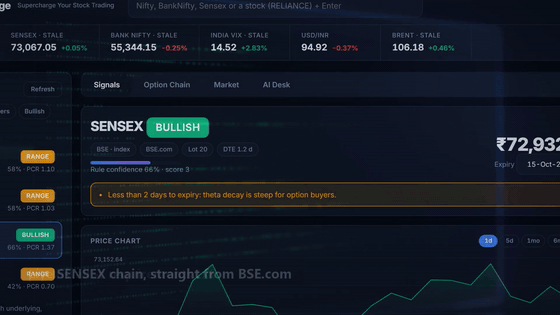
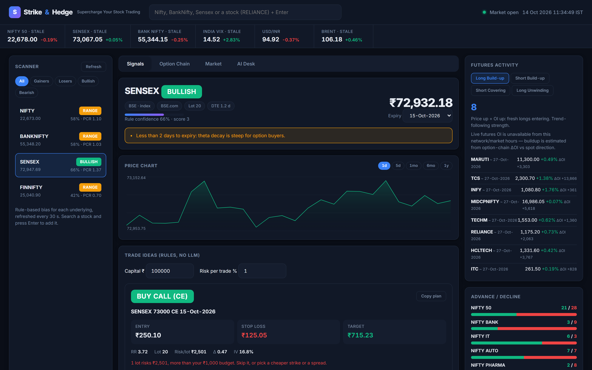

# Strike & Hedge

### Supercharge Your Stock Trading

**Live NSE + BSE option chains → rule-based bias → a concrete trade plan with entry, stop, target, lots and an exit rule.**
Signals need no API key. An optional multi-agent AI desk (chain / volatility / flow / news analysts → bull vs bear
debate → risk → portfolio manager) sits on top of the same numbers.



▶ **[Watch the 30-second demo (MP4)](https://github.com/85599/Strike-and-Hedge/blob/main/docs/demo.mp4)**

<p>
  <a href="LICENSE"></a>
  <a href="https://github.com/85599/Strike-and-Hedge/actions/workflows/ci.yml"></a>
  
  
  
  
  <a href="https://github.com/85599/Strike-and-Hedge/stargazers"></a>
</p>

> **Educational research tool. Not investment advice**, and not issued by a SEBI-registered research analyst.
> Levels come from rules and LLM text and can be wrong. Options can expire worthless; futures can gap through
> stops. Never risk more than you can afford to lose.

---

## Why it exists

Most free option-chain viewers hand you a wall of numbers and stop there. Strike & Hedge answers the next
question — *"so what do I actually do?"* — and shows its working:

| | Typical chain viewer | Strike & Hedge |
|---|---|---|
| Option chain | one exchange, raw OI | NSE **and** BSE, normalised, Greeks attached |
| Verdict | none | `BULLISH` / `BEARISH` / `RANGE` / `AVOID` + a score and written reasons |
| Trade plan | none | instrument, entry, stop, target, R:R, lots, max loss in ₹, exit rule |
| Risk | "good for one lot" | refuses to round up: if one lot risks more than your capital × risk %, it says so |
| Audit trail | none | every AI call logged and scored later against the underlying's move |

## What you get

- **Signals tab — no key required.** The session's own move, measured in ATRs of *that* underlying, PCR (OI and
  volume), max pain, call/put OI walls, ATM IV, expected move from ATR and IV, OI buildup on both sides of the trade
  (writing *and* buying), India VIX level and its session change, RSI / MACD / Bollinger / EMA-SMA. Scored into a
  bias with plain-English reasons.
- **Concrete plans, never naked selling.**
  - Bullish → **BUY CE** (first strike beyond ATM), plus a **futures long** where a futures quote resolves
  - Bearish → **BUY PE**, plus a **futures short** where a futures quote resolves
  - Range → **defined-risk credit spreads** — sell near the OI wall, buy a hedge two strikes further out
  - Option stops and targets derive from ATR and OI walls on the *underlying*, converted to premium through delta,
    so they react to real price geometry instead of a fixed percentage.
- **Lot calculator.** Type capital and risk %; every card shows how many lots fit and the rupee risk per lot.
- **Scanner.** NIFTY, BANKNIFTY, SENSEX and FINNIFTY out of the box; search any F&O stock (or MIDCPNIFTY) and press
  Enter to add it. Bias refreshes every 30 s.
- **Option chain tab.** ±12 strikes around ATM, OI bars, ΔOI, IV, LTP, walls, ATM row highlighted.
- **Market tab.** Sector advance/decline, futures buildup categories, breadth across index members.
- **AI Desk tab.** The full agent pipeline, with a guard: the LLM is given the rule engine's numbers, and if its
  quoted entry is far from the live premium (e.g. it mistakes a strike for a premium) the rule-engine level is shown
  instead with a warning.
- **Decision log.** Each AI call is scored later against the underlying's move with a hit/miss flag, and the lessons
  feed back into later runs.
- **8 LLM backends** for the desk: Anthropic, OpenAI, Gemini, DeepSeek, Groq, OpenRouter, **Ollama (fully local, no
  key)** and any OpenAI-compatible endpoint (vLLM, LM Studio).

## Quick start

```bash
git clone https://github.com/85599/Strike-and-Hedge.git
cd Strike-and-Hedge
pip install -r requirements.txt

cp .env.example .env          # optional: paste ONE LLM key for the AI desk
uvicorn server:app --port 8000
```

Open <http://localhost:8000>. The Signals, Option Chain and Market tabs work with **no key at all** — `.env` is only
for the AI desk.

```bash
python -m pytest tests -q        # 41 offline tests: no network, no keys
python tests/ui_harness.py       # the full UI on synthetic data → http://127.0.0.1:8765
```

No frontend build step: `web/` is plain HTML/CSS/JS served by FastAPI.



## How a signal is built

```
 NSE option-chain-v3 ─┐
 BSE DerivOptionChain ─┤→ chain.py  normalise + Black-Scholes Greeks / IV
 niftyindices.com ─────┤        ↓
 Yahoo quotes/VIX ─────┘   analytics.py   PCR · max pain · OI walls · expected move
                                  ↓
                            signals.py    bias + entry / stop / target / exit / lots
                                  ↓
                     dataflows.py → agents.py → graph.py   (optional AI desk)
                                  ↓
                            reporting.py  markdown report + decision log
```

## Data sources (and the honest caveats)

This is a **scraper, not a licensed feed.** Everything is read from public endpoints at request time and cached
briefly. As of October 2026:

| Need | Source | Notes |
|---|---|---|
| NSE index/stock chains | `option-chain-v3` + `option-chain-contract-info` | the old `option-chain-indices` endpoint is retired |
| BSE (SENSEX) chain | `DerivOptionChain` | needs the expiry as `15 Oct 2026`; BSE publishes **no** expiry list, so upcoming Thursdays are probed |
| BSE ΔOI | same payload | BSE reports `Absolute_Change_OI` as 0 intraday — treat it as "not published yet", not "flat" |
| Option IV | NSE sends it; BSE does not | BSE legs get IV solved from the premium; unsolvable deep-ITM quotes show `—` instead of a fake 500% |
| FINNIFTY daily history | niftyindices.com | Yahoo delisted `^CNXFINANCE`; NSE's own chart API returns empty for every index |
| FINNIFTY intraday chart | **none available** | the panel falls back to recent daily bars and labels that it did |
| Quotes, India VIX, macro | NSE `allIndices`, Yahoo Finance | lot sizes in `copilot/universe.py` are fallbacks; the live lot wins when present |
| Futures quotes | **NSE retired `quote-derivative`** | `quote-v2` and `last-price-v5` are 404 too, so index futures basis and futures OI are not scored; the buildup panel estimates from option ΔOI and says so |

Both exchanges sit behind Akamai, so plain `requests` gets 403s: the clients use `curl_cffi` with a Chrome TLS
fingerprint and warm cookies, and fall back to `requests` if it is unavailable. Endpoints change and rate-limits
bite without notice — if a chain will not load, open `/api/diag/NIFTY` to see what each source actually returned.

**SEBI revises lot sizes**, so verify them with your broker. Publishing buy/sell calls publicly may require SEBI
Research Analyst registration — keep that in mind before you share output.

## Project layout

```
server.py            FastAPI app + REST API + static UI
copilot/
  nse.py bse.py      option chains and futures (unofficial endpoints, anti-bot sessions)
  chain.py greeks.py normalise chains, Black-Scholes Greeks, implied volatility
  analytics.py       PCR, max pain, OI walls, expected move
  signals.py         the rule engine: bias + entry / stop / target / exit / lots
  indicators.py      RSI, MACD, Bollinger, ATR, VWMA
  market.py          quotes, indices, VIX, history, news, charts
  dataflows.py       data packs handed to the analysts
  agents.py graph.py the AI desk: analysts → debate → risk → portfolio manager
  jobs.py memory.py  background runs, report files, decision log
web/                 dashboard (vanilla JS, no build step)
tests/               41 offline tests + a synthetic-data UI harness
docs/                demo video, GIF preview, screenshots
```

## API

| Endpoint | Purpose |
|---|---|
| `GET /api/signal/{sym}?expiry=` | rule-based signal, chain rows, futures, VIX, technicals |
| `GET /api/scan?symbols=NIFTY,SENSEX` | one-line bias + primary setup per underlying |
| `GET /api/quote/{sym}` · `/api/indices` | live quotes with source provenance |
| `GET /api/chart/{sym}?range=1d..5y` | OHLC series for the price panel |
| `POST /api/runs` · `GET /api/runs/{id}` | start / poll the AI desk |
| `GET /api/runs/{id}/report` | full markdown report |
| `GET /api/diag/{sym}` | what each price source returned (debugging) |
| `GET /api/market-overview` · `/api/advance-decline` · `/api/futures-activity` | breadth panels |

## Known limits

- No intraday chart for FINNIFTY (no public source); the panel labels the daily-bar fallback.
- BSE discontinued Bankex index options, so BANKEX gives a quote but no chain — it errors clearly rather than
  silently loading SENSEX.
- Signals are computed from a chain snapshot, not tick data; near the 15:30 IST close the settled expiry is dropped
  so you never get a ₹0.05 premium with nonsense Greeks.
- Single-user local tool: no auth, no database, no rate limiting. Do not expose it to the internet as-is.

## Contributing

Issues and PRs welcome — especially for exchange endpoint changes, lot sizes and strike-step corrections. Run
`python -m pytest tests -q` before opening a PR; the suite is offline on purpose so it stays runnable anywhere.

Idea worth stealing: the rule engine is deliberately separate from the LLM, so you can keep the deterministic part
and delete `agents.py` / `graph.py` entirely if you only want the chain and the signals.

## License

MIT — see [LICENSE](LICENSE).

Sibling projects: [Research-Copilot-Pro](https://github.com/85599/Research-Copilot-Pro) ·
[MarketMitra-AI](https://github.com/85599/MarketMitra-AI)
